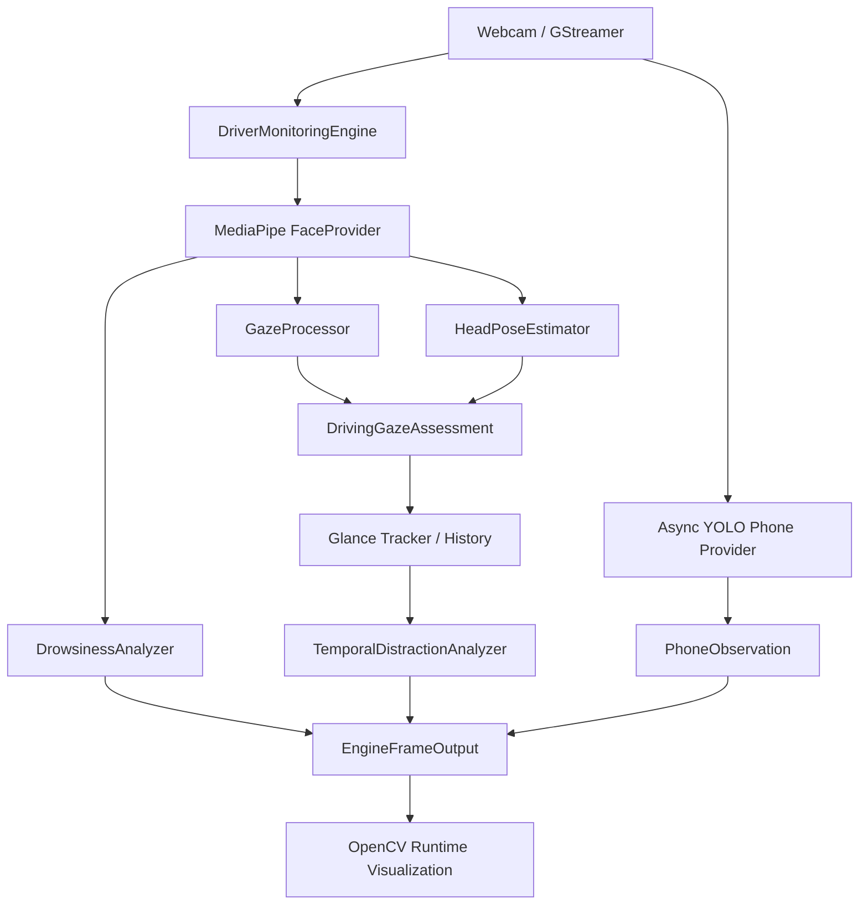

# DriveSense AI

DriveSense AI is a CPU-first in-cabin Driver Monitoring System prototype. It
uses MediaPipe Face Landmarker, GStreamer, and OpenCV to investigate fatigue,
visual distraction, and future driver-monitoring capabilities.

The repository separates reusable production modules from calibration,
benchmark, data-collection, and live-demo experiments. The current work does
not claim regulatory compliance or production distraction classification.


## Architecture

```text
Camera / GStreamer
    -> MediaPipe Face Runtime
         -> Gaze Processor
         -> Head Pose
         -> Drowsiness Analyzer
         -> FaceObservation
    -> Async YOLO Phone Provider
         -> PhoneObservation
    -> DriverMonitoringEngine
         -> EngineFrameOutput
         -> Runtime Visualization
```



Reusable code is under `src/drivesense/`. Experiment scripts under
`experiments/` import those modules and preserve the project's research and
calibration history.

## Project structure

```text
.
├── configs/
│   ├── default.yaml
│   └── README.md
├── docs/
├── experiments/
│   ├── face_landmarker/
│   ├── head_pose/
│   ├── integration/
│   └── video_processing/
├── knowledge_base/
├── notebooks/
│   ├── phone_detection_data_preparation.ipynb
│   ├── phone_detection_training.ipynb
│   └── phone_detection_training_kaggle.ipynb
├── artifacts/
│   └── phone_detection/
├── models/
├── src/
│   └── drivesense/
│       ├── config.py
│       ├── face/
│       ├── head_pose/
│       ├── phone/
│       └── visual_distraction/
├── tests/
│   ├── unit/
│   ├── integration/
│   └── README.md
├── pyproject.toml
└── requirements.txt
```

## Production modules

| Module | Responsibility |
|---|---|
| `drivesense.config` | Load and validate YAML settings. |
| `drivesense.engine` | Run one independent DMS frame-processing cycle. |
| `drivesense.phone.runtime` | Adapt YOLO phone detections to `PhoneObservation`. |
| `drivesense.face.runtime` | CPU MediaPipe Face Landmarker and GStreamer helpers. |
| `drivesense.head_pose` | Relative rotation-vector estimation and valid history. |
| `drivesense.visual_distraction.gaze` | Iris geometry, calibration, and classification. |
| `drivesense.visual_distraction` | Assessment, glance events, history, and temporal analysis. |

Module-specific design and test details are documented in:

- [Face runtime](src/drivesense/face/README.md)
- [Head pose](src/drivesense/head_pose/README.md)
- [Visual distraction](src/drivesense/visual_distraction/README.md)
- [Configuration](configs/README.md)
- [Tests](tests/README.md)
- [Notebooks](notebooks/README.md)
- [Final artifacts](artifacts/phone_detection/README.md)

## Phone detection

The prepared phone-only dataset is under `data/processed/phone_detection/`.
Raw data remains unchanged.

The project includes:

- Data preparation: [phone_detection_data_preparation.ipynb](notebooks/phone_detection_data_preparation.ipynb)
- YOLO11n training: [phone_detection_training.ipynb](notebooks/phone_detection_training.ipynb)
- Kaggle-run notebook export:
  [phone_detection_training_kaggle.ipynb](notebooks/phone_detection_training_kaggle.ipynb)
- Final model and evaluation bundle:
  [artifacts/phone_detection/](artifacts/phone_detection/)

The completed YOLO11n run used a 640-pixel image size and achieved:

| Split | Precision | Recall | mAP@50 | mAP@50-95 |
|---|---:|---:|---:|---:|
| Validation | 0.8809 | 0.8649 | 0.9168 | 0.6804 |
| Test | 0.8835 | 0.8202 | 0.8805 | 0.6481 |

These are measured training-run results. The test split is used only for final
evaluation and was not used to tune the model.

## Configuration

Runtime settings are in [configs/default.yaml](configs/default.yaml). The
current configuration preserves the existing behavior:

- CPU MediaPipe delegate.
- Camera index `0`, resolution `640x480`.
- Face detection, presence, and tracking confidence `0.5`.
- Head-pose history window `2` seconds.
- Prototype glance criteria: `3` seconds, `10` seconds within `30` seconds,
  and `2` seconds re-engagement.

The temporal values are engineering criteria inspired by protocol examples,
not universal thresholds and not proof of driver distraction.

## Installation and tests

```powershell
./.venv/Scripts/python.exe -m pip install -e ".[test]"
./.venv/Scripts/python.exe -m pytest
```

For CPU-only MediaPipe and project modules, install the repository
dependencies normally. Phone detection CUDA support is optional and requires a
CUDA-enabled PyTorch build matching the installed NVIDIA driver and toolkit:

```powershell
python -m pip install torch==2.5.1+cu121 torchvision==0.20.1+cu121 --index-url https://download.pytorch.org/whl/cu121
python -m pip install ultralytics
```

Do not assume every CUDA build is compatible with every NVIDIA GPU or driver.

The ordinary test suite uses synthetic inputs and deterministic clocks; it
does not require a physical camera.

## Live Webcam Testing

A live webcam integration probe was performed with `640x480` frames and the
Windows camera. The natural-gaze calibration file used by the runtime contains
299 valid gaze samples. The probe processed 139 frames over approximately 5
seconds and observed the following repeatable Face/Gaze/Drowsiness outputs:

- Face: `AVAILABLE`
- Gaze: `ON_REFERENCE`
- Overall gaze result: `ATTENTIVE`
- Drowsiness: `OPEN`
- PERCLOS: `0%`
- Distraction: `ATTENTIVE`

This result documents live webcam behavior under one stationary test
condition only. It is not a validation of gaze accuracy, drowsiness detection,
distraction thresholds, or end-to-end phone behavior. It should not be
interpreted as Euro NCAP, regulatory, or clinical compliance evidence.

An additional timed end-to-end smoke run completed 201 processed frames in
8.67 seconds, with 32.43 average FPS and zero camera read failures. This is
an integration/stability observation, not an accuracy or hardware benchmark.

## Live Stability Measurement

A 120-second timed webcam run completed `3561` frames with `0` camera read
failures. The measured averages were:

| Metric | Result |
|---|---:|
| Duration | 120.38 s |
| Processed frames | 3561 |
| Average FPS | 32.27 |
| Average frame loop | 30.99 ms |
| Initial RSS | 847.84 MB |
| Final RSS | 482.36 MB |
| Peak RSS | 1563.19 MB |
| Average process CPU | 48.51% |

This was one local Windows webcam run. It is not a multi-hour endurance test,
multi-user evaluation, or sustained-memory-leak proof.

## Running experiments

From the repository root:

```powershell
./.venv/Scripts/python.exe experiments/face_landmarker/landmark_inspection/inspect.py
./.venv/Scripts/python.exe experiments/face_landmarker/ear_calibration/calibrate.py
./.venv/Scripts/python.exe experiments/face_landmarker/eye_openness/calibrate.py
./.venv/Scripts/python.exe experiments/face_landmarker/eye_closure/monitor.py
./.venv/Scripts/python.exe experiments/face_landmarker/gaze/calibrate.py
./.venv/Scripts/python.exe experiments/face_landmarker/gaze/monitor.py
./.venv/Scripts/python.exe experiments/head_pose/monitor.py
./.venv/Scripts/python.exe experiments/integration/live.py
./.venv/Scripts/python.exe experiments/integration/live.py --duration 10
```

Live scripts require a compatible webcam and GStreamer installation. Press
`Q` or `Esc` to stop display-based monitors.

## Documentation

- [Problem definition](docs/01_problem_definition.md)
- [Requirements](docs/02_requirements.md)
- [System architecture](docs/03_system_architecture.md)
- [Model selection](docs/04_model_selection.md)
- [Driving gaze and distraction](docs/05_driving_gaze_and_distraction.md)
- [Integration contract](docs/06_integration_contract.md)
- [Final release record](docs/07_final_release.md)
- [Repository dependency map](docs/08_repository_dependency_map.md)
- [Demo recording guide](demo/README.md)
- [Experiments](experiments/README.md)

## Current limitations

- The camera-centered gaze reference is not a complete driving-region model.
- `POTENTIAL_DISTRACTION` is a preliminary temporal result.
- `UNAVAILABLE` means that an assessment is not currently possible; it does
  not mean the driver is attentive.
- Head pose is currently an availability/supporting signal, not an independent
  distraction criterion.
- The MediaPipe Windows runtime is CPU-only in the tested environment.
- Phone-usage detection and final alert decisions are not implemented.
