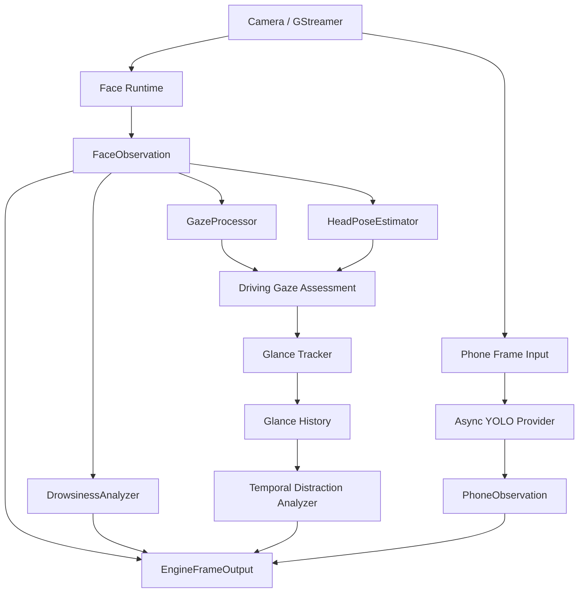

# System Architecture

## 1. High-Level Architecture

The current implementation separates reusable production modules from
calibration, benchmark, and live-demo scripts:



`src/drivesense/` contains reusable implementation code. `experiments/`
contains procedures and scripts that collect data, run calibration, benchmark
performance, or display live experimental output. Experiment modules depend on
production modules; production modules do not import experiment scripts.

The current visual-distraction path is:

```text
Gaze Classification
    -> Driving Gaze Assessment
    -> Glance Tracker
    -> Glance History
    -> Temporal Distraction Analyzer
```

`POTENTIAL_DISTRACTION` is a preliminary temporal result, not a regulatory or
production distraction decision.
## 2. Video Processing Strategy

### 2.1 Design Approach

DriveSense AI will use a modular video processing architecture designed to support real-time operation while considering the computational and memory limitations of future Edge deployment environments.

The video processing layer was evaluated using two complementary technologies:

- **GStreamer:** Selected for camera input management, video streaming, buffering, and frame handling.
- **OpenCV:** Used for image processing operations such as resizing, color conversion, drawing, and other frame-level transformations.

### 2.2 Design Considerations

The video processing pipeline shall follow these principles:

- Minimize unnecessary frame buffering to reduce memory consumption.
- Avoid processing outdated frames when the system cannot maintain the camera's input frame rate.
- Keep camera acquisition independent of AI inference operations.
- Allow configurable input resolution and processing frequency.
- Support different camera sources without changing the core application logic.
- Consider hardware acceleration when supported by the deployment platform.

### 2.3 Technology Evaluation

GStreamer and OpenCV were evaluated through practical benchmarking before
finalizing the video processing implementation.

The evaluation will consider:

- CPU utilization.
- RAM consumption.
- Video processing FPS.
- Frame processing latency.
- Frame dropping behavior.
- Stability during continuous video capture.

The final implementation will prioritize resource efficiency, low latency, and portability across different hardware environments.

### 2.4 Current Technology Direction

| Component | Proposed Technology |
|---|---|
| Video Capture & Pipeline | GStreamer |
| Image Processing | OpenCV |
| AI Inference | MediaPipe Face Landmarker (CPU) |
| Performance Benchmarking | Completed; GStreamer + MediaPipe selected |

The MediaPipe pipeline comparison is documented in
[`experiments/video_processing/mediapipe_pipeline/results.md`](../experiments/video_processing/mediapipe_pipeline/results.md).

## 3. Production Modules

| Module | Responsibility |
|---|---|
| `drivesense.config` | Load and validate YAML runtime configuration. |
| `drivesense.face.runtime` | CPU MediaPipe Face Landmarker and GStreamer helpers. |
| `drivesense.engine` | Orchestrate frame processing into one `EngineFrameOutput`. |
| `drivesense.phone.runtime` | Synchronous/asynchronous YOLO adapter for phone observations. |
| `drivesense.visual_distraction.gaze` | Iris geometry, calibration, and gaze classification. |
| `drivesense.head_pose` | Relative rotation-vector estimation and valid-sample history. |
| `drivesense.visual_distraction` | Gaze assessment, glance tracking, history, and temporal analysis. |

The model, camera, and prototype temporal values are defined in
[`configs/default.yaml`](../configs/default.yaml). The 3/10-within-30/2-second
values remain explicitly documented prototype criteria inspired by evaluation
examples, not universal scientific thresholds.
