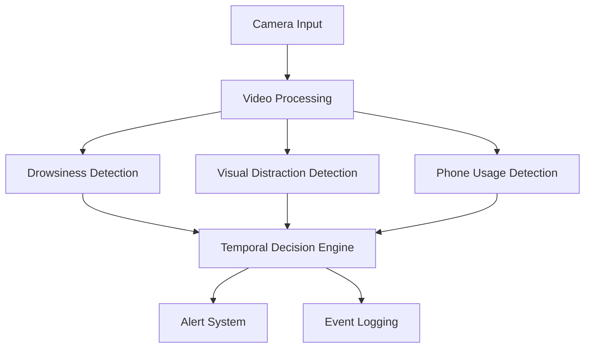

# System Architecture

## 1. High-Level Architecture

The following diagram illustrates the main components
and data flow of DriveSense AI.

## 2. Video Processing Strategy

### 2.1 Design Approach

DriveSense AI will use a modular video processing architecture designed to support real-time operation while considering the computational and memory limitations of future Edge deployment environments.

The video processing layer was evaluated using two complementary technologies:

- **GStreamer:** Selected for camera input management, video streaming, buffering, and frame handling.
- **OpenCV:** Used for image processing operations such as resizing, color conversion, drawing, and other frame-level transformations.

### 2.2 Design Considerations

The video processing pipeline shall follow these principles:

- Minimize unnecessary frame buffering to reduce memory consumption.
- Avoid processing outdated frames when the system cannot maintain the camera's input frame rate.
- Keep camera acquisition independent of AI inference operations.
- Allow configurable input resolution and processing frequency.
- Support different camera sources without changing the core application logic.
- Consider hardware acceleration when supported by the deployment platform.

### 2.3 Technology Evaluation

GStreamer and OpenCV were evaluated through practical benchmarking before
finalizing the video processing implementation.

The evaluation will consider:

- CPU utilization.
- RAM consumption.
- Video processing FPS.
- Frame processing latency.
- Frame dropping behavior.
- Stability during continuous video capture.

The final implementation will prioritize resource efficiency, low latency, and portability across different hardware environments.

### 2.4 Current Technology Direction

| Component | Proposed Technology |
|---|---|
| Video Capture & Pipeline | GStreamer |
| Image Processing | OpenCV |
| AI Inference | MediaPipe Face Landmarker (CPU) |
| Performance Benchmarking | Completed; GStreamer + MediaPipe selected |

The MediaPipe pipeline comparison is documented in
[`experiments/video_processing/mediapipe_pipeline/results.md`](../experiments/video_processing/mediapipe_pipeline/results.md).
