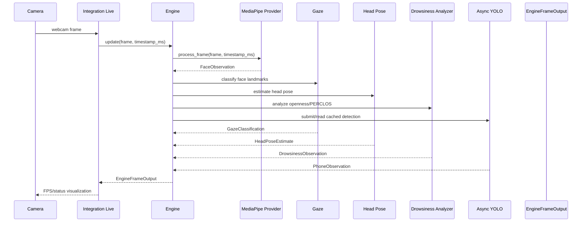
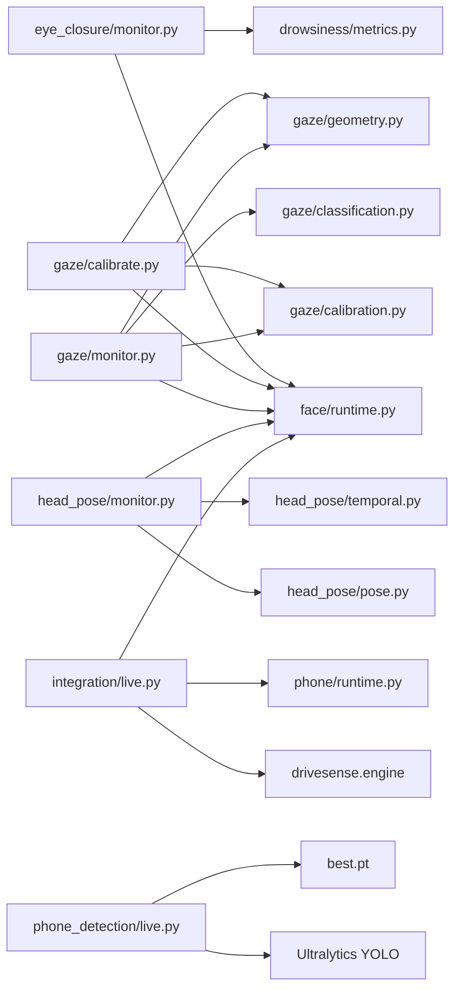

# DriveSense Repository Dependency Map

This document maps the actual Python imports and runtime call relationships
between the project's source modules, experiments, and tests. It describes the
current implementation, not an idealized future architecture.

## 1. Runtime entry point

The complete live camera runtime is:

[`experiments/integration/live.py`](../experiments/integration/live.py).

```mermaid
flowchart TD
    Live["experiments/integration/live.py"] --> Config["src/drivesense/config.py"]
    Live --> Engine["src/drivesense/engine.py"]
    Live --> FaceRuntime["src/drivesense/face/runtime.py"]
    Live --> PhoneRuntime["src/drivesense/phone/runtime.py"]
    Live --> EyeCalibration["gaze/calibration.py"]

    Engine --> Contract["src/drivesense/integration_contract.py"]
    Engine --> FaceRuntime
    Engine --> HeadPose["head_pose/pose.py"]
    Engine --> HeadTemporal["head_pose/temporal.py"]
    Engine --> GazeProcessor["gaze/classification.py"]
    Engine --> Drowsiness["drowsiness/analyzer.py"]
    Engine --> GlanceTracker["visual_distraction/glance_tracker.py"]
    Engine --> GlanceHistory["visual_distraction/glance_history.py"]
    Engine --> Distraction["visual_distraction/temporal.py"]
    Engine --> Assessment["visual_distraction/assessment.py"]
    Engine --> PhoneRuntime

    FaceRuntime --> Config
    FaceRuntime --> Contract
    FaceRuntime --> MediaPipe["MediaPipe Tasks"]

    GazeProcessor --> GazeGeometry["gaze/geometry.py"]
    GazeProcessor --> GazeCalibration["gaze/calibration.py"]

    Drowsiness --> DrowsinessMetrics["drowsiness/metrics.py"]
    Drowsiness --> EyeHelpers["face/runtime.py"]
    Drowsiness --> Contract

    HeadTemporal --> Config
    HeadTemporal --> HeadPose

    Distraction --> Config
    Distraction --> Assessment
    Distraction --> GlanceHistory
```

## 2. Frame processing sequence

## 3. Experiment-to-production relationships

## 4. Test dependency relationships

```mermaid
flowchart TD
    TestEngine["test_engine.py"] --> Engine["engine.py"]
    TestEngine --> Contract["integration_contract.py"]

    TestFace["test_face_runtime.py"] --> FaceRuntime["face/runtime.py"]
    TestFace --> Contract

    TestPhone["test_phone_runtime.py"] --> PhoneRuntime["phone/runtime.py"]
    TestPhone --> Contract

    TestGaze["test_gaze.py"] --> GazeModules["gaze modules"]
    TestDrowsy["test_drowsiness.py"] --> Drowsiness["drowsiness modules"]
    TestHead["test_head_pose.py"] --> HeadPose["head_pose modules"]
    TestConfig["test_config.py"] --> Config["config.py"]

    IntegrationTest["test_visual_distraction_pipeline.py"]
    IntegrationTest --> Assessment["assessment.py"]
    IntegrationTest --> Tracker["glance_tracker.py"]
    IntegrationTest --> History["glance_history.py"]
    IntegrationTest --> Temporal["temporal.py"]
```

## 5. Central source files

- [`src/drivesense/engine.py`](../src/drivesense/engine.py):
  Main orchestration and one-frame processing cycle.
- [`src/drivesense/integration_contract.py`](../src/drivesense/integration_contract.py):
  Shared typed status and output contracts.
- [`src/drivesense/face/runtime.py`](../src/drivesense/face/runtime.py):
  MediaPipe, GStreamer, frame conversion, and eye helpers.
- [`src/drivesense/drowsiness/analyzer.py`](../src/drivesense/drowsiness/analyzer.py):
  Eye-openness closure and PERCLOS analysis.
- [`src/drivesense/visual_distraction/gaze/classification.py`](../src/drivesense/visual_distraction/gaze/classification.py):
  Gaze processor and gaze-direction classification.
- [`src/drivesense/head_pose/pose.py`](../src/drivesense/head_pose/pose.py):
  Relative head-pose estimation.
- [`src/drivesense/phone/runtime.py`](../src/drivesense/phone/runtime.py):
  Synchronous/asynchronous YOLO phone-provider adapters.
- [`experiments/integration/live.py`](../experiments/integration/live.py):
  Complete webcam runtime and visualization.
- [`configs/default.yaml`](../configs/default.yaml):
  Camera, MediaPipe, temporal, and drowsiness settings.
- [`tests/unit/`](../tests/unit/) and [`tests/integration/`](../tests/integration/):
  Regression and integration coverage.

## 6. Compatibility and wrapper relationships

Several small compatibility modules re-export production implementations for
older experiment import paths. Examples include wrappers under
`experiments/face_landmarker/gaze/`, `experiments/head_pose/`, and
`src/visual_distraction/`. Production code should import from
`src/drivesense/`; experiment wrappers are for research/call-site compatibility
and should not contain separate monitoring logic.
